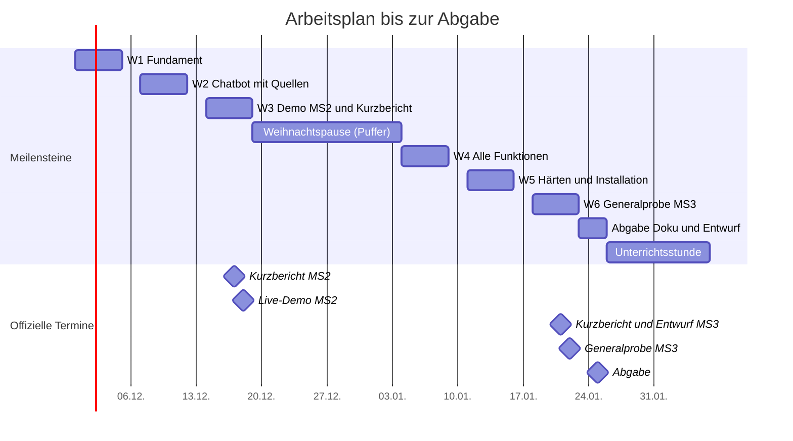

# Arbeitsplan – Chatbot zu Friedrich III. (Gruppe 2, Frankfurt am Main, RI XIII H. 4)

**Stand:** 27.11.2026 · **Zeitraum:** 30.11.2026 bis zur Abgabe am 25.01.2027 (danach die Unterrichtsstunde am 29.01. oder 05.02.)

Der Plan setzt eigene, wöchentliche Meilensteine (**W1–W6**). Die offiziellen Termine der Prüfungsleistung sind darin als feste Abgaben eingeplant. Jeder Meilenstein endet freitags mit einem kurzen Teamtreffen (Demo des Stands, Abgleich, nächste Woche festlegen).

---

## 1. Ausgangslage

| Bereich | Stand | Quelle |
|---|---|---|
| Neo4j mit RI-alles | läuft lokal per `docker compose`, Import vollständig (212.176 Regesten, davon 1.054 in H. 4) | [docker-compose.yml](docker-compose.yml) |
| 10 Fragen einer Lehrkraft, Abbildung aufs Modell | fertig, 5 Fragen mit Basismodell lösbar, 5 brauchen bzw. profitieren von der Ergänzung | [Aufgabe 1](aufgaben/Aufgabe1_Frankfurt_RI_XIII_H4.md) |
| Fallstricke | 3 bekannte + 15 weitere (A–O) beschrieben und nachgeprüft | [Aufgabe 2](aufgaben/aufgabe2_fallstricke.md) |
| Architektur | React + FastAPI + Agentic Harness + MCP (Neo4j, Wikidata) | [Aufgabe 3](aufgaben/Aufgabe3_Systemarchitektur/README.md) |
| MCP-Tools | spezifiziert (8 Tools inkl. `legal_acts`), noch nicht implementiert | Aufgabe 1, Abschnitt 2.1 |
| LLM-Extraktion H. 4 (Pilot) | für alle 1.054 Regesten fertig: 1.101 Rechtsakte, 1.456 Rollen, automatische Prüfung ohne Fehler; Importskript liegt vor | [ri13_h4_llm_annotationen/](ri13_h4_llm_annotationen/) |
| Offen bei der Extraktion | **Ausweitung auf ganz RI XIII** (alle Hefte, rund 26.000 Regesten), Goldstandard bewerten, Import in die eigene Instanz, Abfragen 3/7/10 gegenprüfen, Dubletten der Registerverknüpfungen prüfen | ebd., „Noch zu tun“ |
| Code der App | noch nicht im Repo (der Chatbot-Prototyp mit Qwen3-8B liegt außerhalb) | – |

**Bekannte Stolpersteine aus der Einrichtung**

- Das Importskript legt Textknoten mit `CREATE` an. Ein zweiter Lauf von `setup` (z. B. durch `docker compose up` oder den Start-Button des ganzen Projekts in Docker Desktop) erzeugt doppelte Texte. Danach muss das Volume gelöscht und neu importiert werden.
- Der Import dauert über 30 Minuten und lädt alle Daten live von GitLab. Netzaussetzer brechen ihn ab. Für „App startet auf einem fremden Rechner“ brauchen wir deshalb einen anderen Weg (siehe Abschnitt 5).

**LLM-Extraktion für ganz RI XIII**

Die Ergänzung (Rechtsakte und genauere Rollen, Modell aus Aufgabe 1, Abschnitt 5) wird für **alle Regesten Friedrichs III.** erzeugt, nicht nur für Heft 4. Heft 4 dient als Pilot: Pipeline, Prüfregeln und Importformat sind dort erprobt. Für die Ausweitung ändert sich:

| Thema | Heft 4 (Pilot) | ganz RI XIII |
|---|---|---|
| Umfang | 1.054 Regesten | rund 26.000 Regesten in 41 Heften, ca. 25-mal so viel |
| Vokabular | aus den Verben von Heft 4 abgeleitet | an einer Stichprobe aus anderen Heften prüfen, neue Typen nur mit Begründung, danach einfrieren (`prompt_version: v2`) |
| Chmel-Regesten | Dubletten bekannt (124 ↔ 136) | Regesten, die in einem Heft neu bearbeitet sind, nur einmal extrahieren (Heftfassung); Chmel ist anders erschlossen (Fallstrick H), Rollen dort nur, wo Register-Entities vorhanden sind |
| Lauf | einmalig | in Paketen pro Heft, wiederaufnehmbar nach Abbruch, Fortschritt protokolliert |
| Modell | ein Modell | ein festes Modell für alle Hefte, Kosten und Laufzeit vorab an einem Heft messen |
| Prüfung | automatische Prüfung + 50 Regesten Goldstandard | automatische Prüfung für alle; Goldstandard als geschichtete Stichprobe über mehrere Hefte (Heft 4 + 3–4 weitere, je ca. 30 Regesten) |
| Import | `importKey` `llm-v1:H4:…` | `importKey` mit Heft-Kennung, pro Heft idempotent importierbar und rückgängig zu machen |

---

## 2. Bereiche und Verantwortung

Vier Bereiche entlang der Architektur. Bei drei Personen übernimmt eine Person zwei Bereiche (naheliegend: DB + MCP, weil die Tools direkt auf den Abfragen aufbauen). Weil die LLM-Extraktion für ganz RI XIII den DB-Bereich stark belastet, hilft die Backend-Person dort beim LLM-Zugang (gleicher LLM-Client) und alle beim Goldstandard. Die Zuordnung bitte im Team festlegen und hier eintragen.

| Bereich | Inhalt | verantwortlich |
|---|---|---|
| **DB** | Neo4j-Instanz (Import, Read-only-Benutzer, Indizes), **LLM-Extraktion für ganz RI XIII** (Pipeline, Lauf, Import, Goldstandard), Datenqualität (Dubletten, Koordinaten), Cypher-Abfragen für die Tools, GDS-Projektionen und -Kennzahlen, Datenbank-Dump für die Installation | _Name_ |
| **MCP** | Neo4j-MCP-Server mit den festen Tools (Aufgabe 1, Abschnitt 2.1), Regeln gegen die Fallstricke in jedem Tool, Tools für Rechtsakte und Personennetzwerk, Wikidata-MCP-Server für den Steckbrief | _Name_ |
| **Backend** | FastAPI, Agentic Harness, MCP-Client, LLM-Konfiguration (THM-KI-Dienst ↔ freier Dienst), Quellenprüfung, Antwortformat für das Frontend, Docker-Setup der ganzen App und Installationsanleitung | _Name_ |
| **Frontend** | React-Oberfläche: Chat mit Quellenliste, Karte, Zeitleiste, Personennetzwerk, Steckbrief, Quellenansicht; Bedienbarkeit für die Klasse | _Name_ |

**Gemeinsam:** Testfragen auswerten, Kurzberichte, Dokumentation, Unterrichtsentwurf, Generalprobe, Unterrichtsstunde (jede Person übernimmt einen Teil der Stunde).

**Schnittstellen**, die früh festgelegt werden (W1):

- DB ↔ MCP: Cypher-Abfragen je Tool, Rückgabefelder (immer `identifier` und Link)
- MCP ↔ Backend: Tool-Namen, Parameter und Ergebnisformat (MCP-Tool-Schema)
- Backend ↔ Frontend: JSON der Antwort (Text, Quellenliste, Daten für Karte/Zeitleiste/Netzwerk/Steckbrief)

**Arbeitsweise:** Issues auf GitHub pro Aufgabe, Feature-Branches mit Pull Request und Review durch eine zweite Person, `main` bleibt lauffähig.

---

## 3. Zeitplan im Überblick

| Meilenstein | Zeitraum | Ergebnis (Abnahme am Freitag) | offizieller Termin |
|---|---|---|---|
| **W1 Fundament** | 30.11.–04.12. | Repo-Struktur, Schnittstellen festgelegt, LLM umschaltbar, erste MCP-Tools antworten, Ergänzung H. 4 importiert, Extraktions-Pipeline für alle Hefte verallgemeinert | – |
| **W2 Chatbot mit Quellen** | 07.12.–11.12. | Chatbot beantwortet die 5 Basisfragen mit Regestenlinks; Chat, Karte, Zeitleiste im Browser; Extraktion für ganz RI XIII läuft | – |
| **W3 Demo MS2** | 14.12.–18.12. | Kurzbericht abgegeben, Demo geprobt und gehalten | Bericht 17.12., Demo 18.12. |
| Pause | 19.12.–03.01. | Puffer, nur Liegengebliebenes (freiwillig) | – |
| **W4 Alle Funktionen** | 04.01.–08.01. | Personennetzwerk (GDS), Steckbrief (Wikidata), Quellenansicht, Ergänzung für ganz RI XIII importiert und im Chatbot | – |
| **W5 Härten und Installation** | 11.01.–15.01. | Testlauf aller Fragen, App startet auf einem fremden Rechner, Doku und Unterrichtsentwurf im Entwurf | – |
| **W6 Generalprobe MS3** | 18.01.–22.01. | Kurzbericht + Unterrichtsentwurf abgegeben, Generalprobe gehalten | Bericht 21.01., Probe 22.01. |
| **Abgabe** | 23.01.–25.01. | Dokumentation und Unterrichtsentwurf final | 25.01., 23:59 Uhr |
| **Stunde** | 26.01.–05.02. | Unterrichtsstunde mit der App, Material am Tag | 29.01. oder 05.02. |

---

## 4. Meilensteine im Detail

### W1 – Fundament (30.11.–04.12.)

**Ziel:** Alle vier Bereiche haben ein lauffähiges Grundgerüst, das miteinander spricht.

| Bereich | Aufgaben |
|---|---|
| DB | LLM-Ergänzung mit [import_llm_annotationen.cypher](ri13_h4_llm_annotationen/import_llm_annotationen.cypher) in die eigene Instanz importieren, Abfragen der Fragen 3, 7 und 10 dort gegenprüfen · Goldstandard: [Prüfliste](ri13_h4_llm_annotationen/Pruefliste_Goldstandard_H4.xlsx) von zwei Personen unabhängig bewerten (Präzision und Trefferquote, für den Bericht) · Dubletten der Registerverknüpfungen (44 Regesten) prüfen · prüfen, ob die Ausstellungsorte Koordinaten haben (RI-Places) · Read-only-Benutzer für den MCP-Server anlegen · **Extraktion RI XIII vorbereiten:** Pipeline von Heft 4 auf beliebige Hefte verallgemeinern (Heft als Parameter, Pakete, Wiederaufnahme, `importKey` mit Heft-Kennung), Liste aller Hefte mit Regestenzahl, Chmel-Dubletten für alle Hefte bestimmen, Vokabular an einer Stichprobe aus 3–4 anderen Heften prüfen, Kosten und Laufzeit an einem zweiten Heft messen |
| MCP | Neo4j-MCP-Server aufsetzen (Python MCP SDK), erste Tools `search_regesta`, `get_regest`, `find_entity` · Tool-Schemas für alle 8 Tools festlegen · Link auf regesta-imperii.de aus `identifier`/`urn` bilden |
| Backend | Repo-Struktur (`db/`, `mcp/`, `backend/`, `frontend/`, `docs/`) · FastAPI mit Endpunkt `/chat` · LLM-Client mit Konfiguration (`.env`: Anbieter, URL, Modell, Schlüssel) für den THM-KI-Dienst und einen freien Dienst; beide einmal erfolgreich aufgerufen · MCP-Client verbindet sich mit dem Neo4j-MCP-Server · Prototyp-Chatbot ins Repo übernehmen · JSON der Antwort ans Frontend festlegen |
| Frontend | React-Projekt mit Grundlayout (Chat links, Ansichten rechts als Reiter) · Chat-Komponente gegen `/chat` · Bibliotheken festlegen (Vorschlag: Leaflet für die Karte, vis-timeline oder ein Balkendiagramm für die Zeitleiste, Cytoscape.js oder Sigma.js für das Netzwerk) |

**Abnahme:** Eine Frage im Browser geht über Backend und LLM an ein MCP-Tool und kommt mit Treffern zurück. Die LLM-Ergänzung für Heft 4 ist in der Instanz, die Goldstandard-Zahlen für Heft 4 liegen vor. Die Pipeline läuft für ein zweites Heft fehlerfrei durch, das Vokabular `v2` ist festgelegt.

### W2 – Chatbot mit Quellen (07.12.–11.12.)

**Ziel:** Der Chatbot beantwortet die Basisfragen korrekt und belegt jede Aussage.

| Bereich | Aufgaben |
|---|---|
| DB | Cypher-Abfragen für alle Basis-Tools mit den Regeln gegen die Fallstricke (nur RI XIII, Chmel-Dubletten ausfiltern, Platzhalter-Ort „-“ ausschließen, Datumsspannen, `count(DISTINCT …)`, Registerhierarchie) · Ergebnisse gegen die geprüften Zahlen aus Aufgabe 1 testen · fehlende Koordinaten ergänzen · **Extraktion für alle Hefte starten**, Heft für Heft mit automatischer Prüfung; Fortschritt und Fehlerquote pro Heft protokollieren (Zahlen für den Kurzbericht) |
| MCP | Restliche Tools: `regesta_by_entity`, `itinerary`, `count_regesta`, `co_recipients` · jedes Tool liefert `identifier` und Link mit · Tool-Beschreibungen so schreiben, dass auch kleine Modelle das richtige Tool wählen |
| Backend | Agentic Harness: Tool-Schleife, Systemprompt („nur aus Tool-Ergebnissen antworten, sonst sagen, dass es nicht belegt ist“) · **Quellenprüfung im Code:** jede genannte Regestennummer muss in den Tool-Ergebnissen vorkommen, sonst wird die Antwort verworfen oder markiert · Antwort mit Quellenliste und Daten für Karte/Zeitleiste |
| Frontend | Quellenliste unter jeder Antwort mit Links auf regesta-imperii.de · **Karte** (Ausstellungsorte aus `itinerary`, Anzahl als Markergröße, Lücke „ohne Ort“ angezeigt) · **Zeitleiste** (Regesten pro Jahr/Jahrzehnt aus `count_regesta`, Klick zeigt Regesten) |
| alle | Testprotokoll: die 10 Fragen aus Aufgabe 1 mit beiden LLM-Diensten stellen, Ergebnis gegen die geprüften Zahlen vergleichen (richtig, Quellen korrekt, nichts erfunden) |

**Abnahme:** Fragen 1, 2, 5, 8 und 9 liefern richtige Antworten mit Regestenlinks, mit beiden LLM-Diensten. Karte und Zeitleiste zeigen Heft 4.

### W3 – Demo Meilenstein 2 (14.12.–18.12.)

**Ziel:** Kurzbericht pünktlich, Demo sitzt.

- **Mo–Mi:** nur noch Fehler beheben, keine neuen Funktionen (Feature-Freeze für die Demo). Fragen 4 und 6 mit der Ergänzung verbessern, soweit es schon geht.
- **Mi:** Kurzbericht (1–2 Seiten) schreiben, Gliederung nach den Punkten der Aufgabenstellung:

| Punkt im Kurzbericht | Inhalt aus | verantwortlich |
|---|---|---|
| Eigene Instanz, RI-alles importiert | Abschnitt 1, W1 | DB |
| Tools/Abfragen und Lösung der Fallstricke | Tool-Liste mit Regeln (W2) | MCP + DB |
| Beantwortete Fragen mit Quellen | Testprotokoll W2 | Backend |
| Stand der LLM-Ergänzung, Annotationen mit Herkunft | Heft 4 importiert mit Goldstandard-Zahlen; Fortschritt der Extraktion für ganz RI XIII (Hefte fertig/offen, Fehlerquote); Modell aus Aufgabe 1, Abschnitt 5.2/5.3 | DB |
| Laufende Funktionen (mind. 2) | Chatbot, Karte, Zeitleiste (+ Quellenlinks) | Frontend |
| Probleme und Plan bis zur Stunde | dieser Arbeitsplan, W4–W6 | Backend |
| Aufteilung in der Gruppe | Abschnitt 2 | alle |

- **Do 17.12.:** Abgabe in Moodle. Demo zweimal durchspielen (5 Minuten, festes Drehbuch mit 3 Fragen, Plan B: Bildschirmaufnahme, falls Netz oder LLM-Dienst ausfallen).
- **Fr 18.12.:** Live-Demo.

### Weihnachtspause (19.12.–03.01.)

Kein Pflichtprogramm. Die Extraktion für die restlichen Hefte kann in dieser Zeit unbeaufsichtigt weiterlaufen. Wer Zeit hat: Liegengebliebenes aus W2/W3 oder Vorarbeiten für W4 (GDS-Projektion ausprobieren, Wikidata-MCP-Server auswählen). Erstes Treffen danach: Montag, 04.01.

### W4 – Alle Funktionen (04.01.–08.01.)

**Ziel:** Alle sechs Funktionen der App laufen.

| Bereich | Aufgaben |
|---|---|
| DB | **Extraktion abschließen:** letzte Hefte, Import aller Hefte in die Instanz · **Goldstandard RI XIII:** geschichtete Stichprobe (Heft 4 + 3–4 weitere Hefte, je ca. 30 Regesten) von zwei Personen bewerten, Präzision und Trefferquote pro Heft und gesamt · **GDS:** Projektion „Personen, die in denselben Regesten vorkommen“ (Heft 4, wahlweise alle Regesten Friedrichs III.), Kennzahlen PageRank/Degree und Louvain-Communities · Abfragen für Rechtsakte und neue Rollen der Ergänzung |
| MCP | Tools `person_network` und `legal_acts` · Wikidata-MCP-Server auswählen bzw. anbinden (Personen und Orte), Ergebnisse als externe Quelle kennzeichnen |
| Backend | Wikidata-Tool in den Harness einbinden, Ausgabe **als externe Quelle markieren** · Quellenprüfung auch für Netzwerk und Steckbrief · Fragen 3, 7 und 10 über die Ergänzung beantworten |
| Frontend | **Personennetzwerk** (Knotengröße = Bedeutung, Farbe = Community, Klick öffnet Steckbrief) · **Steckbrief** (Daten aus dem Graphen + deutlich abgesetzter Block „Externe Quelle: Wikidata/Wikipedia“) · **Quellenansicht** (Regest im Volltext mit Link auf regesta-imperii.de) |

**Abnahme:** Alle 10 Fragen aus Aufgabe 1 laufen durch, Fragen 3, 7 und 10 auch für andere Hefte; alle sechs Ansichten sind im Browser bedienbar; die Ergänzung ist für alle Hefte in der Instanz, Goldstandard-Zahlen für RI XIII liegen vor.

### W5 – Härten und Installation (11.01.–15.01.)

**Ziel:** Die App ist stabil, belegt verlässlich und startet nach Anleitung auf einem fremden Rechner.

| Bereich | Aufgaben |
|---|---|
| DB | Datenbank-Dump einer geprüften Instanz (RI-alles + Ergänzung) erzeugen und Laden beim ersten Start automatisieren; `setup` darf nur einmal laufen (siehe Abschnitt 5) |
| MCP | Erweiterte Testfragen (ca. 20, auch Fangfragen ohne Beleg und Fragen außerhalb von Heft 4) gegen die Tools · Fehlerfälle (leere Treffer, mehrdeutige Namen) sauber zurückmelden |
| Backend | **Installation auf einem fremden Rechner** (Rechner einer Person, die nicht entwickelt hat): `docker compose` für Neo4j, MCP-Server, Backend und Frontend, Schritt-für-Schritt-README · Umschalten der LLM-Dienste in der Anleitung · Fehlerbehandlung (LLM-Dienst nicht erreichbar) |
| Frontend | Oberfläche für die Klasse vereinfachen (Beispielfragen als Knöpfe, verständliche Fehlermeldungen) |
| alle | Testprotokoll als Tabelle für die Dokumentation · Dokumentation im Entwurf: Architektur (aktualisiert), Datenmodell und Ergänzung, Tools und Fallstricke, Evaluation, Installation · **Unterrichtsentwurf, erste Fassung:** Ablauf 30 Minuten, Aufgaben für die Klasse, Rollen der drei Gruppenmitglieder |

**Abnahme:** Installation auf dem fremden Rechner hat ohne Hilfe geklappt; Testprotokoll ohne erfundene Aussagen; Entwürfe von Doku und Unterricht liegen vor.

### W6 – Generalprobe Meilenstein 3 (18.01.–22.01.)

- **Mo–Mi:** Kurzbericht MS3 schreiben und Unterrichtsentwurf überarbeiten; letzte Fehlerkorrekturen (keine neuen Funktionen mehr).
- **Mi:** Probedurchlauf der Stunde im Team (mit Stoppuhr, die App auf den Geräten der „Klasse“ testen: Wie greifen die anderen Studierenden zu? WLAN, Adresse, Last).
- **Do 21.01.:** Abgabe Kurzbericht + Entwurf der Stunde.
- **Fr 22.01.:** Generalprobe (10 Minuten), Rückmeldungen notieren.

### Abgabe (23.01.–25.01.)

- Rückmeldungen aus der Generalprobe in Dokumentation und Unterrichtsentwurf einarbeiten.
- Dokumentation final: Installation nochmals auf einem frischen Rechner nachvollziehen.
- **Mo 25.01., 23:59 Uhr:** Abgabe in Moodle. Version im Repo taggen (`v1.0-abgabe`).

### Unterrichtsstunde (29.01. oder 05.02.)

- Ab 26.01.: Material für die Klasse fertigstellen (Arbeitsblatt, Zugangsdaten/Link zur App), App am Vortag auf dem Vorführrechner starten und prüfen.
- Am Tag: 30 Minuten Unterricht + 15 Minuten Diskussion, alle drei übernehmen einen Teil.

---

## 5. Risiken und Gegenmaßnahmen

| Risiko | Auswirkung | Gegenmaßnahme | Bereich | bis |
|---|---|---|---|---|
| Import dauert >30 Min., bricht bei Netzproblemen ab, ein zweiter Lauf erzeugt Duplikate | App startet nicht auf fremdem Rechner, Mindestanforderung verfehlt | Datenbank-Dump (`neo4j-admin database dump`) einer geprüften Instanz bereitstellen und beim Start laden; `setup` nur einmal ausführen lassen (Prüfung „Datenbank schon gefüllt?“) | DB | W5 |
| LLM erfindet Regesten oder Fakten | Mindestanforderung verfehlt | Feste Tools statt freiem Cypher, Quellenprüfung im Code, Testfragen mit Fangfragen | MCP, Backend | W2, W5 |
| THM-KI-Dienst oder freier Dienst nicht erreichbar | Demo/Stunde fällt aus | Beide Dienste regelmäßig testen; Plan B für Demo und Stunde (zweiter Dienst, Bildschirmaufnahme) | Backend | W3, W6 |
| Kleine Modelle rufen Tools unzuverlässig auf | falsche oder leere Antworten | wenige, klar beschriebene Tools; Modelle früh vergleichen; Ergebnisse im Testprotokoll festhalten | MCP, Backend | W2 |
| Koordinaten der Orte fehlen | Karte unvollständig | Koordinaten aus RI-Places prüfen, Lücken über Wikidata ergänzen oder einmalig von Hand für Heft 4 | DB | W2 |
| Extraktion für ganz RI XIII dauert zu lange oder ist zu teuer (ca. 25-mal Heft 4, Rate-Limits des LLM-Dienstes) | Ergänzung bis zur Stunde unvollständig | Kosten und Laufzeit in W1 an einem zweiten Heft messen; Lauf früh starten (W2) und über die Pause laufen lassen; Reihenfolge nach Bedeutung (Heft 4 und große Hefte zuerst); Chatbot nennt, für welche Hefte die Ergänzung vorliegt | DB | W1, W4 |
| Vokabular aus Heft 4 passt nicht zu anderen Heften | viele `other`, schlechtere Qualität | Vokabular in W1 an Stichprobe anderer Hefte prüfen und als `v2` einfrieren; Anteil `other` pro Heft überwachen | DB | W1, W2 |
| Herkunft der LLM-Ergänzung wird in der Prüfung hinterfragt | Rückfragen | `source`, `model` und `prompt_version` an jeder Annotation; Goldstandard-Zahlen in der Doku | DB | W1 |
| Klasse kann im Unterricht nicht auf die App zugreifen | Stunde ohne Mitmachen | Zugriff im Netz des Raums bei der Generalprobe testen; Ausweichlösung: Gruppenarbeit an wenigen Geräten | Backend | W6 |
| Ausfall eines Gruppenmitglieds | Bereich bleibt liegen | Pull-Request-Reviews durch eine zweite Person, damit jede Komponente von zwei Leuten verstanden wird | alle | laufend |
