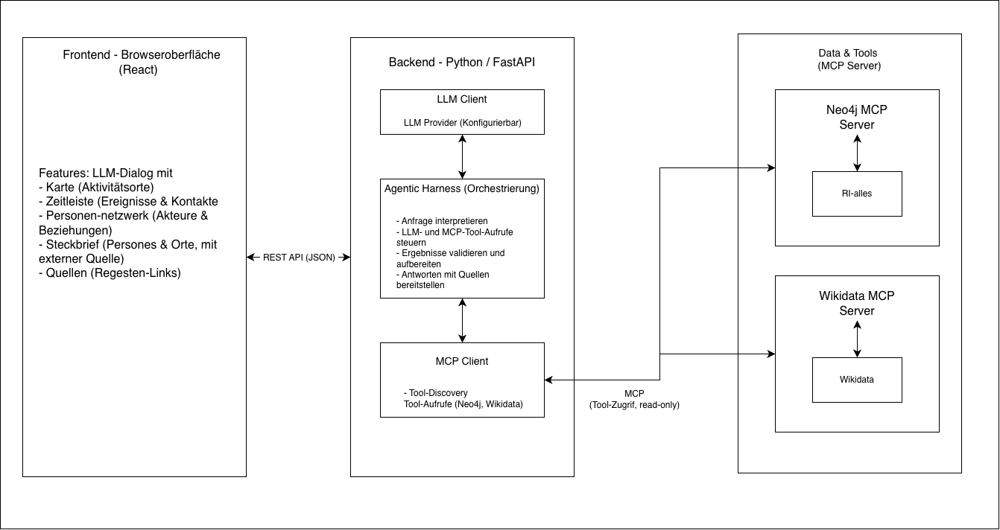

# Systemarchitektur – Regesta-Imperii-Chatbot

## 1. Überblick

Wir planen eine browserbasierte Chatbot-Anwendung für den Geschichtsunterricht. Die Anwendung soll Fragen zu den Regesta Imperii beantworten und Ergebnisse durch Karten, Zeitleisten, Personennetzwerke und Steckbriefe visualisieren.

Die Architektur besteht aus drei Bereichen:

- **Frontend:** React
- **Backend:** Python / FastAPI mit Agentic Harness, LLM Client und MCP Client
- **Daten & Tools:** Neo4j MCP Server (RI-alles) und Wikidata MCP Server

## 2. Frontend – React

React stellt die Benutzeroberfläche bereit und kommuniziert über eine REST-API (JSON) mit dem Backend.

Geplante Funktionen: Chat, Karte, Zeitleiste, Personennetzwerk, Steckbrief und Quellenansicht.

Die Visualisierungen werden anhand strukturierter Daten vom Backend erstellt. Beispielsweise können bei geografischen Fragen Orte mit Markierungen und der Anzahl zugehöriger Regesten auf einer Karte erscheinen.

## 3. Backend – Python / FastAPI

**Was ist FastAPI?**

FastAPI ist ein Python-Webframework zur Entwicklung von HTTP-APIs. Damit können wir beispielsweise einen Endpunkt `/chat` bereitstellen, über den das React-Frontend Fragen sendet und Antworten empfängt.

**Warum FastAPI?**

- Unser bestehender Chatbot-Prototyp verwendet bereits Python.
- Gute Unterstützung für asynchrone Verarbeitung.
- Automatische Validierung und API-Dokumentation.
- Einfache Integration unserer bestehenden LLM- und MCP-Logik.

[FastAPI-Dokumentation](https://fastapi.tiangolo.com/)

### Agentic Harness

Der Agentic Harness übernimmt die zentrale Orchestrierung:

- Benutzeranfragen verarbeiten und an das LLM weitergeben.
- Geeignete MCP-Tools auswählen und ausführen lassen.
- Ergebnisse validieren und aufbereiten.
- Antworten mit Quellen und Visualisierungsdaten bereitstellen.

Das LLM übernimmt die sprachliche Interpretation. Deterministische Aufgaben wie Berechnungen und Datenfilterung sollen möglichst durch Code oder Datenbankabfragen erfolgen.

## 4. LLM Client und Inference Engine

Der **LLM Client** kommuniziert über eine OpenAI-kompatible API mit dem Sprachmodell.

Die **Inference Engine** führt das LLM aus. Beispiele sind Unsloth Studio, llama.cpp und vLLM.

Unser bisheriger Prototyp verwendet **Unsloth Studio mit Qwen3-8B (Q4_K_M)**.

Weitere Modellbeispiele aus der Vorlesung:

| Modell | Quantisierung |
| --- | --- |
| Qwen3.6-35B-A3B | Q8 |
| Qwen3.8-27B | Q8 |
| Gemma-4-26B-A4B | Q8 |
| Qwen3.8-Flash-Next | Q4 |
| gpt-oss-120b | Q4 |

Für das Projekt sollen der THM-KI-Dienst und ein alternativer LLM-Dienst per Konfiguration austauschbar sein.

Unsloth ist **keine MCP-Komponente**, sondern dient zur lokalen Ausführung des Sprachmodells.

## 5. MCP Client und MCP Server

Das **Model Context Protocol (MCP)** ermöglicht den standardisierten Zugriff auf externe Werkzeuge und Datenquellen.

Der MCP Client befindet sich im Python-Backend. Er entdeckt verfügbare Tools, führt Tool-Aufrufe über die jeweiligen MCP-Server aus und gibt die Ergebnisse an den Agentic Harness zurück.

**Neo4j MCP Server:**

- Verbindung zur gemeinsamen RI-alles-Datenbank.
- Lesender Zugriff über Cypher-Tools.
- RI-alles dient als primäre Quelle für historisch belegte Antworten.

**Wikidata MCP Server:**

- Zugriff auf externe Informationen zu Personen und Orten.
- Unterstützung für die Steckbrief-Funktion.
- Wikidata-Informationen werden als externe Quelle gekennzeichnet.

**Dokumentation:**

- [MCP-Spezifikation (2026-07-28)](https://modelcontextprotocol.io/specification/2026-07-28)
- [Python MCP SDK](https://github.com/modelcontextprotocol/python-sdk)
- [Neo4j MCP](https://neo4j.com/developer/genai-ecosystem/model-context-protocol-mcp/)

## 6. Beispielhafter Datenfluss

1. Die Lehrkraft stellt eine Frage im React-Frontend.
2. FastAPI übergibt sie an den Agentic Harness.
3. Das LLM interpretiert die Frage und schlägt einen Tool-Aufruf vor.
4. Der MCP Client ruft das entsprechende Tool auf dem Neo4j- oder Wikidata-MCP-Server auf.
5. Der MCP Server liefert die Daten zurück.
6. Das Backend verarbeitet und überprüft die Ergebnisse.
7. Das Frontend zeigt die Antwort mit Quellen und gegebenenfalls einer Visualisierung an.

**Wichtig:** Das LLM greift nicht direkt auf die Datenbanken zu. Der Agentic Harness kontrolliert die Tool-Ausführung. Antworten über Regesten müssen durch RI-alles und entsprechende Quellenlinks belegt sein.

## 7. Noch zu klären

- Verbindung und Schema von RI-alles überprüfen.
- Geeigneten Wikidata MCP Server auswählen.
- LLM-Modelle und Provider vergleichen.
- Bibliotheken für Karte, Zeitleiste und Personennetzwerk festlegen.
- Validierung und Fehlerbehandlung konkretisieren.

Die Architektur ist zunächst ein Entwurf für Meilenstein 1 und wird während der Implementierung überprüft und gegebenenfalls angepasst.
